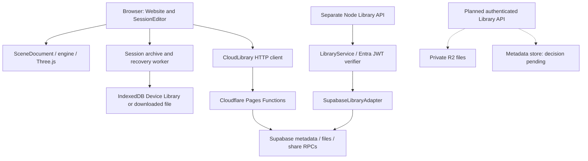

# Auto3D: agent project overview

Analyzed 2026-10-07 against branch `work`, commit `238a93f` (v0.27.0). This is a source-code analysis, not verification of deployed cloud resources. Update this document as implementation changes.

## Current development direction

The user's current goal is **Cloudflare R2 storage and temporary sign-in for per-user Library files**, followed by transition to **Microsoft Entra ID (Azure identity)**. R2 is the active storage direction; Entra remains the identity destination. Earlier all-Azure storage/runtime recommendations are historical rather than the immediate implementation plan.

This checkout now implements temporary Supabase email/password sign-in for administrator-created accounts: same-origin auth routes, secure HTTP-only cookies, provider verification/refresh/logout, AuthService and login under the startup logo. See `docs/temporary-auth.md`. Private Library ownership/upload authorization is still pending. The R2 read/storage metadata work exists remotely on `feat/multi-user-auth-foundation`, PR #16; it is not merged into this checkout. R2 is file storage; choosing it does not select an identity provider.

### Active remote branch: reviewed evidence

Reviewed [PR #16](https://github.com/yuttana858/Auto3D/pull/16), its full diff and discussion, and [branch GOAL.md](https://github.com/yuttana858/Auto3D/blob/feat/multi-user-auth-foundation/GOAL.md). These changes are not present in the local checkout and were not tested here.

- Implemented in the reviewed diff: Pages Library/archive/thumbnail R2 reads through `AUTO3D_LIBRARY_R2`; R2 share archive reads; legacy Supabase Storage fallback; client `fileSize`/`storageProvider` metadata; migration `20261007_r2_object_metadata.sql` adding `storage_provider`, `archive_object_key`, `thumbnail_object_key`, and nonnegative `file_size_bytes`.
- Documented target: private R2 binaries, Supabase PostgreSQL metadata and transitional authorization data, provider-neutral AuthService, users/organizations/memberships/roles/permissions/audit, persistent file-size quota accounting, direct authorized uploads and multipart support, future Entra identity.
- Login placement: below the Auto3D logo after the landing animation loads. The inspected PR diff did not implement login. Subsequently, the user explicitly selected Supabase email/password with admin-created accounts, implemented in this checkout behind AuthService. Admin bootstrap, authenticated Save/Open, named-user shares, quotas and end-to-end multi-user validation remain upcoming work.
- Infrastructure evidence: the PR body says R2 was not activated, but a later [PR comment](https://github.com/yuttana858/Auto3D/pull/16#issuecomment-6040448024) reports activation completed and bucket listing succeeded. It reports bucket creation blocked by Cloudflare authentication error 10000 and calls for private `auto3d-library`, Standard/ENAM, bound as `AUTO3D_LIBRARY_R2`. This is a historical report, not a fresh live-resource check.
- Security gap still present in that diff: published Library reads remain anonymous and publicly cached for five minutes. A private R2 bucket does not make these API reads private. Ownership/session authorization must be added before personal files become available through these paths.

Begin development from the active feature branch after reviewing its latest state. Preserve these overview changes when moving branches; do not overwrite existing feature work. Keep internal user/organization IDs independent of the temporary identity provider, with explicit identity mappings for later Entra linking.

## Product and stack

Auto3D is a browser 3D viewer/editor derived from MIT-licensed Online3DViewer. It imports CAD and mesh formats, assembles multi-object scenes, edits placement and materials, controls HDRI lighting/reflections/shadows, plays embedded skeletal/morph animation, and authors scene/camera keyframes. It saves portable `.auto3d` sessions and device-local Library entries, and opens read-only shared viewers. Meshy generation and curated paper-packaging knowledge are additional integrations.

The frontend uses JavaScript ES modules, imperative DOM UI, Three.js, fflate, Pickr, and CSS. There is no React application or frontend framework to migrate. esbuild bundles the website; rollup/TypeScript generate engine distribution artifacts. The separate Node.js backend uses built-in HTTP and crypto APIs. CI targets Node 22; backend requires Node >=22.

## Architecture and code map



The planned API is not implemented. The Pages Functions and Node API are **separate implementations**, not a single chain; the Pages routes do not call `LibraryService`.

| Area | Entry points | Responsibility |
| --- | --- | --- |
| App bootstrap | `source/website/index.js`, `website/index.html` | Creates Website, loads UI, exposes `window.Auto3D` |
| Viewer orchestration | `source/website/website.js` | Import pipeline, toolbar, panels, navigation, viewer settings |
| Editing/session orchestration | `source/website/sessioneditor.js` | Selection, transforms, history, archive open/save, recovery, read-only share mode |
| Scene state | `source/website/scenedocument.js` | Objects, duplication, hierarchy/material copies, SceneHistory |
| Portable document | `source/website/sessionarchive.js` | Packing, migrations, validation, ZIP read/write |
| Recovery | `sessionrecovery.js`, `sessionrecoverypack.js`, `sessionrecoveryworker.js` under `source/website/` | Background archive packing and device-local checkpoints |
| Library UI/local storage | `source/website/modellibrary.js` | DeviceLibrary, nested folders, save destinations, cards, shares |
| Browser remote client | `source/website/cloudlibrary.js` | Library HTTP reads and share requests; Save currently throws |
| Animation | `sessionanimation.js`, `sessiontimeline.js`, `advanceanimation.js` under `source/website/` | Embedded clips and scene/camera timelines |
| Appearance | `materialpanel.js`, `lightingpanel.js`, `preferences.js` under `source/website/` | Materials, lighting, units, preferences |
| Engine | `source/engine/{import,export,model,geometry,viewer,threejs,io}` | Format support, geometry/model representation, rendering |
| Agent commands | `source/website/agentcommands.js`, `commandregistry.js`, `commandpanel.js` | Schemas, serialization, macro execution, command UI |
| Pages APIs | `functions/api/` | Library, shares, HDRI catalog, AI proxy, knowledge, health |
| Alternate backend | `backend/server.mjs`, `library-service.mjs`, `auth/entra-jwt.mjs`, `adapters/supabase.mjs` | Node routes, privileged publication, JWT roles, persistence |
| Deployment | `.github/workflows/cloudflare-pages.yml`, `tools/build_pages.mjs` | Builds `build/pages`, deploys Pages project `auto3d` |

## Essential data flows

**Import/edit:** input files enter Website's import path, engine importers produce model data, SessionEditor adds session objects to SceneDocument, and the viewer renders Three.js objects. Keep model state, rendered state, selection/history, dirty state, and serialized state consistent when changing editing behavior.

**Save:** Library save UI calls `SessionEditor.ArchiveAsync`, using the recovery worker packing path. The result goes to IndexedDB or an explicit file save/download. A selected model or full scene can be archived. Remote upload is disabled today. Reuse this archive preparation path for cloud saves rather than inventing another model representation.

**Open:** local or remote archive bytes pass through `OpenArchive` and archive validation before replacing/appending scene state. Open replaces the workspace; Add appends objects. Animation reopens paused.

**Recovery:** edits trigger a debounced device-local checkpoint; packing waits during dragging/playback and can reuse worker geometry snapshots. Recovery is not cloud sync. Explicit full-session save/discard clears the checkpoint. Cloud auth work must preserve this local behavior.

## Library implementation today

### Device Library

`DeviceLibrary` in `modellibrary.js` uses IndexedDB database `sw-auto3d-library`, version 1, object store `saves` keyed by `id`. Reserved `__auto3d_` records contain folders and recovery and are omitted from normal item listing. Items contain archive data, thumbnail, name, category, kind/object count, and timestamps.

Folders are path strings, not relational entities. Normalization bounds paths to eight segments and segment names to 60 characters. Add/rename/delete/move/bulk-delete use IndexedDB transactions; deleting a folder moves its saved items to its parent or Uncategorized. These are browser/origin-local records and are not account-owned or automatically uploaded.

### Remote Library client

`CloudLibrary` defaults to same-origin `/api`; `window.AUTO3D_LIBRARY_API_URL` overrides the origin for development. `Request` uses fetch without injecting a bearer token or an auth abstraction. Its Item mapper returns `shared: true` for all remote entries: personal cloud entries will need an explicit distinction from published/shared items.

Existing paths:

| Method/path | Current use |
| --- | --- |
| GET `/api/library/items` | List published entries |
| GET `/api/library/items/{id}` | Metadata |
| GET `/api/library/items/{id}/archive` | Portable session bytes |
| GET `/api/library/items/{id}/thumbnail` | Thumbnail bytes |
| POST `/api/share` | Create a persistent share token |
| GET `/api/share/{token}` | Share metadata |
| POST `/api/share/{token}/archive` | Code-checked viewer archive |
| POST `/api/share/{token}/download` | Code-checked optional download |

The save destination UI disables Shared Library; `CloudLibrary.Save` also throws. Authentication must be integrated with both UI state and actual backend enforcement before enabling upload.

### Deployed-route source: Pages Functions

`functions/api/library/[[path]].js` uses Supabase REST/Storage through server-side fetch with required `SUPABASE_URL` and `SUPABASE_SECRET_KEY`, shared with the share route through `functions/_lib/supabase.js`. Missing/invalid configuration fails with 503; there is no prototype project/key fallback. New secret keys use `apikey`; legacy JWTs also use bearer auth. `/api/health` performs a bounded metadata read and returns 200/503 for database readiness. It filters `status=published`, permits GET without an authenticated actor, and rejects non-GET requests with 503. Archives/thumbnails currently use public five-minute cache headers. That caching policy is unsuitable for private user files.

`functions/api/share/[[path]].js` uses Supabase tables/RPCs for share creation and verification. Creation is currently anonymous for an existing published item. Tokens are UUIDs; optional access codes are four digits and hashed with the token. Archive responses use private/no-store. Download permission controls the explicit download endpoint, but viewers necessarily receive renderable archive data. Private cloud items must not be reachable through legacy public ID reads.

Share metadata lookup rejects expired/invalid expiry timestamps; archive/code verification delegates to the RPC. Review actual database functions/policies before carrying these semantics forward. Do not infer a deployed share schema solely from the migration files present here.

### Alternate Node backend

`backend/server.mjs` exposes health and Library CRUD routes, including multipart publication. `LibraryService` validates metadata, requires Entra publisher/admin roles for Publish and admin roles for Delete. Its List/Get/Download methods are public and have no owner context. `created_by` is stored during publication, but this is provenance, not per-user isolation.

`SupabaseLibraryAdapter` implements metadata and file persistence together. Publish writes immutable UUID paths, uploads archive/thumbnail, inserts metadata, and attempts cleanup on failure. Delete marks metadata archived before deleting files. There is no personal-library ownership filter. For R2, decide whether to split metadata and object storage interfaces so they can be tested and migrated independently.

The Entra verifier checks RS256 signature, issuer, audience, expiry/not-before and returns subject/tenant/roles/groups. This is backend token verification, not a browser login implementation. It uses Node crypto and process-env defaults; do not copy it into Pages Functions without reviewing runtime compatibility and the chosen identity provider.

## Portable session contract

Source of truth: `SessionVersion = 5` in `source/website/sessionarchive.js`. `.auto3d` is a ZIP containing `session.json`, format marker `SW Auto3D`. Readers migrate v1→v2→v3→v4→v5 and reject unsupported newer versions.

v3 added user metadata, v4 added cast/receive shadows, and v5 added object keyframes and scene/camera timeline defaults. Archives retain model/material/texture data, transforms, visibility, view settings, and embedded animation resources. Current local limits include 256 MB compressed/expanded payloads and 1,000 objects. The existing Node publication service separately limits archives to 64 MB. Establish a consistent cloud-size/quota policy before implementing uploads.

Do not change the session schema merely to add remote storage. Ownership, sharing, and cloud revision metadata belong in backend metadata unless there is a specific portability requirement.

## R2 + per-user auth implementation plan

These are recommended next steps, not claims about existing infrastructure.

1. Confirm the implementation branch, auth provider, account identity model, and intended runtime (Pages Functions or a separate Worker). Confirm whether the old public Library remains a separate catalog.
2. Define an authenticated actor with stable provider/issuer + subject identity (and tenant where relevant). Never take owner identity from upload metadata or use email as the sole durable key.
3. Follow the active branch's Supabase PostgreSQL metadata direction. Extend it for owners, organization membership, identity mappings, folders, versions, file keys, quotas and share grants. Do not introduce another metadata store without a reason and an explicit change of plan. R2 alone does not provide the application's indexed/transactional metadata model.
4. Add private R2 bindings and storage operations behind the API. Use server-generated object keys; validate ownership before any metadata, archive, or thumbnail access. Do not treat a key prefix alone as authorization.
5. Add a provider-appropriate sign-in/callback/logout/session flow and an API authentication boundary. Choose cookie or token handling deliberately; cookie-authenticated mutations need CSRF protection, and cross-origin token requests need explicit CORS behavior. Verify current provider/Cloudflare documentation during implementation.
6. Implement personal list/save/open/delete first. Existing role-based publication is a different permission from managing one's own files. Define rename, move, folders, overwrite vs immutable revisions, concurrency conflicts, quotas, and upload failure cleanup.
7. Integrate a Personal/Cloud destination into ModelLibrary. Keep Device/File destinations available. Handle signed-out, expired-session, upload progress, retry, and error states; clear account-specific lists/thumbnail URLs when switching accounts.
8. Make sharing an owner-authorized action that creates a revocable scoped grant. Resolve that grant independently from the normal owner API. Define expiry, code-attempt limits, download behavior, and what happens after deletion/revision.
9. Migrate legacy published files only through an explicit migration plan. Preserve IDs/share links where required; existing `created_by` data may not establish ownership in the new provider. Never silently claim legacy or device files for an account.
10. Add agent commands on the same application functions, refresh the command catalog, test isolation and round trips, then validate preview deployment before production publication.

Required acceptance cases: user A cannot list/read/download/delete/rename/share user B's files even with a known item ID or object key; missing/expired auth fails; thumbnails are private too; account switching cannot expose stale data; failed uploads do not create usable partial entries; private reads are not publicly cached; revoked/expired shares fail; local saves/recovery still work; session v5 textures/animation survive cloud save/open.

## Agent development rules

Read root `AGENTS.md` before edits. Every new user-facing action requires a stable command in `agentcommands.js` using CommandRegistry, with strict schema, example, category/description, mutation flag, and structured result. UI and agents share underlying functions; agents must not depend on DOM clicking or arbitrary evaluation.

Keep `website/assets/commands.json` synchronized with `npm run build_command_catalog`. Commands opening dialogs must report that they opened a dialog, not that save/upload completed. Respect read-only sessions and explicit authorization for remote upload/publication. Add meaningful execution/validation/macro tests for affected commands.

`window.Auto3D` exposes catalog, execute, runMacro, cancelMacro. This is an in-page API, not a deployed MCP server. Inspect `commandregistry.js` and the actual command before assuming read-only/mutation behavior or history support. `SceneHistory` and editor history are the implementation authority; portions of agent-interface documentation about material history are older than current editor behavior.

## Local development and checks

```bash
npm ci
npm start
# http://localhost:8080/website/index.html
npm test
npm run lint
npm run check_licenses
npm --prefix backend test
npm run build_website
node tools/build_pages.mjs
```

`npm start` watches/bundles frontend sources and serves static files with caching disabled. It **does not run Pages Functions**. For integrated R2/auth development, establish a local Cloudflare runtime and local bindings, or explicitly connect a development backend. The Node backend covers Library routes but does not implement the Pages share/AI/environment routes. Load the Wrangler skill and inspect current CLI/config documentation before adding local Cloudflare commands.

`npm run test_browser_animation` requires a running app and Chromium; `BROWSER_EXECUTABLE` and `AUTO3D_TEST_URL` customize it. It covers animation, recovery and Device Library reopen, not authenticated cloud isolation.

Tests to start with: `test/tests/cloudlibrary_test.js`, `pagesapi_test.js`, `session_test.js`, `workspace_test.js`, and `backend/test/*.test.mjs`. CI also builds engine bundles/module/types and audits production dependencies.

Earlier checks in this session at the same commit: 322 frontend/unit tests passed, 11 backend tests passed, lint/license/whitespace checks passed. Backend server tests needed permission to bind localhost in this environment. This analysis did not run a fresh build, browser smoke test, production audit, or deployed-service check.

Deployment pushes to `main` trigger Pages upload using GitHub secrets; manual workflow is also available. The deploy workflow builds/uploads but does not itself run all CI gates. The separate CI workflow runs on pull requests/manual dispatch. No R2/auth resource provisioning is shown in either workflow. Do not push/deploy just to document the project.

## Documentation gaps and next reading

| Document | How to use it |
| --- | --- |
| `README.md` | Product capabilities; some provider/migration text is historical |
| Active feature branch `GOAL.md` | Current R2/PostgreSQL/AuthService direction; Entra remains identity target |
| Local `GOAL.md`, `docs/backend-architecture.md`, `backend/README.md` | Earlier all-Azure data-plane direction; compare with feature branch before implementing |
| `docs/auto3d-session-format.md` | Useful validation contract, but says v4; code is v5 |
| `docs/native-keyframe-animation.md` | Timeline design/background |
| `docs/agent-interface.md` | Command contract, macros, knowledge API; verify history behavior against code |
| `docs/privacy-network-boundary.md`, `docs/pretransition-readiness.md` | Earlier baseline; reassess for authenticated cloud files |
| `docs/cloudflare-pages.md`, `docs/build-maintenance.md` | Hosting/build background; no proof of live resource state |
| `docs/ai-generative.md` | Meshy proxy/key boundary, relevant if account auth later protects AI spending |

Before starting auth/R2 development, verify the latest feature branch, locate/confirm the temporary login provider and session design, and establish permitted users, organization ownership, private/public Library UX, legacy migration requirements, share access expectations, and upload/storage quota policy. PostgreSQL metadata and future Entra identity are already documented directions. Inspect non-secret binding/configuration information; never print or commit credentials.

## Model dimensions and context menu

The viewer navigation dispatches right-clicks to one session menu; right-drag orbit suppresses the menu. Model Data W/L/H map to X/Z/Y and resize the selected object through `SessionEditor.SetObjectDisplayDimension`, shared with `object.dimension` and transform Size inputs. Declared source units convert to the global mm/inches preference; undeclared units remain explicit model units. Dimensions are positive lengths, preserve mirrored scale signs, support undo, and cannot expand a zero-width axis by scaling.
