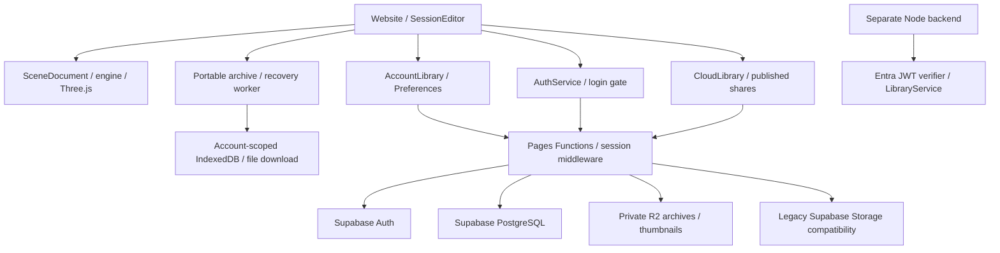

# Auto3D: agent project overview

Updated 2026-10-10. Start with [project-status.md](project-status.md) for the development log, deployed commit, local release, validation and TODO list. This document describes the current application; earlier proposed R2/auth architecture has been superseded by the implemented account routes.

## Product and stack

Auto3D is a browser 3D viewer/editor derived from MIT-licensed Online3DViewer. It imports CAD/mesh files, assembles multi-object scenes, edits transforms/materials, controls environments/lighting, creates arrays, previews polygon reduction, plays embedded animation and authors scene/camera timelines. It saves portable `.auto3d` sessions, private account Library entries and device-local entries. Packaging is an independently built module with cut/score profiles, board extrusion, 0200–0203 folded-box generation and selected-box unfolding. Its geometry, textures and catalog UI load on demand through a small Auto3D adapter; its standalone preview has no account or Auto3D dependency. Render queues produce screen/HD/4K/16K PNGs, including model-only alpha output.

The frontend uses JavaScript ES modules, imperative DOM, Three.js, fflate, Pickr and CSS. There is no React app. esbuild bundles the website and two workers; rollup/TypeScript produce engine distribution artifacts. CI targets Node 22. The separate Node backend is an alternate implementation, not the deployed Pages API.

Current production: Cloudflare Pages Functions, private Cloudflare R2 objects, Supabase Auth/PostgreSQL account metadata. Temporary approved-account email/password login is implemented. Microsoft Entra ID is a future migration; the Node Entra verifier does not mean browser Entra sign-in exists.

## Architecture



| Area | Main entry points | Responsibility |
| --- | --- | --- |
| Bootstrap | `source/website/index.js`, `website/index.html` | Creates website/services, command API, error logs and login gate |
| Viewer | `website.js`, engine `viewer/` | Imports, UI panels, camera/navigation, viewport and rendering |
| Editing | `sessioneditor.js`, `scenedocument.js` | Objects/selection, transforms, arrays/groups, history, dirty state and read-only shares |
| Archive/recovery | `sessionarchive.js`, `sessionrecovery*.js` | Session schema/migrations/validation, worker packing, checkpoints |
| Identity/admin | `authservice.js`, `authgate.js`, `authpanel.js`, `accountadmin.js`; `functions/api/auth/`, `accounts/` | Approved login, session/logout/revocation and admin workflows |
| Account storage | `accountlibrary.js`, `modellibrary.js`; `functions/api/personal/`, `_lib/accountstorage.js` | Owned R2 files/metadata, account/device Library UI |
| Preferences | `preferences.js`, `settings.js`; `functions/api/preferences.js` | Global units, appearance/viewport and account synchronization |
| Legacy published Library | `cloudlibrary.js`; `functions/api/library/`, `share/` | Published items, R2/legacy reads and verified share access |
| Effects | `lightingpanel.js`, engine `sceneeffects.js`, `floorshadow.js` | HDRI/reflections, ambient fill, isolated floor shadows |
| Cameras/rendering | `sessioncameras.js`, `camerapanel.js`, `renderingpanel.js`, `renderqueue.js`, `rendercore.js` | Named views/FOV and tiled PNG queues |
| Animation | `sessionanimation.js`, `sessiontimeline.js`, `advanceanimation.js` | Embedded clips and scene/camera keyframes |
| Optimization | `polygonoptimizer.js`, `polygoncore.js`, `polygonworker.js`, `arraylayout.js` | Bounded static-mesh simplification and array layout |
| Packaging | `modules/packaging/src/`, `packagingadapter.js`, `packagingworkspace.js` | Independent versioned generator/UI build, canonical-mm mesh/profile API, demand loading, flat dielines and Auto3D scene/history adapter |
| Commands/diagnostics | `agentcommands.js`, `commandregistry.js`, `macrodesign.js`, `agentcapture.js`, `errorlogs.js` | Shared agent actions, strict schemas/macros, bounded capture/logs |
| Alternate backend | `backend/server.mjs`, `library-service.mjs`, `auth/entra-jwt.mjs`, `adapters/supabase.mjs` | Separate Node Library API; does not serve as Pages' internal service |
| Release | `.github/workflows/cloudflare-pages.yml`, `tools/build_pages.mjs`, `verify_deployment.mjs` | Build, deploy and check production version/HTML/bundle |

Paths without a directory in this table are under `source/website/` unless identified as engine/backend/tools.

## Critical data flows

**Startup:** install diagnostics and services, restore the secure server session, load the signed-in account's preferences, initialize its Library, then unlock the UI. Explicit logout invalidates client restoration and the server session, returns to login and closes active work. Client gates supplement server enforcement; do not rely on hidden buttons to protect data. Conflicting built-in Light/Dark viewer presets follow Appearance at startup; custom colors, scenic presets and HDRI remain explicit choices. Explicitly opened sessions can restore their saved view/lighting.

**Import/edit:** engine importers create model data; SessionEditor adds objects to SceneDocument and renders converted Three.js objects. Keep engine geometry, rendered objects, selection, history, dirty state and serialized data consistent. Unknown source units stay model units rather than being guessed.

**Save/open:** UI and account commands use the same archive preparation. Account saves write owned R2 archive/thumbnail objects and Supabase metadata through Pages; Device saves use IndexedDB; file saves download `.auto3d`. Open validates bytes before replacing/appending the scene. Full-session save clears the unsaved checkpoint; recovering an unsaved scene retains its checkpoint until saved. Worker bundles must deploy beside the main website bundle.

**Ownership:** private Library APIs authenticate and scope metadata/files to the actor, including thumbnails. DeviceLibrary uses `sw-auto3d-library-<account id>` for signed-in accounts; the unsuffixed legacy database is not automatically claimed. Reserved recovery/folder records are omitted from ordinary item lists. Account switching must invalidate queued work and remove stale lists/blob URLs.

**Published sharing:** `CloudLibrary` handles legacy published/shared data; it is separate from AccountLibrary. Its disabled publication destination is not the personal save path. PR #16 reconciliation preserves R2 and legacy Storage reads, published-status filtering, share verification and private/no-store binary responses behind current API gates. Do not restore obsolete parallel auth/admin routes. Historical SQL under `database/history/pr16/` is archival, not a migration runner.

**3D effects:** metallic fill contributes specular radiance as well as diffuse illumination. Floor shadows use independent projected caster copies and an RGBA mask; original model opacity/materials are untouched. These are floor silhouettes, not physically accurate self-shadow. Capture/render failures must restore renderer targets, viewports, visibility, camera and lighting.

**Manufacturing profiles:** packaging coordinates/caliper are canonical millimeters; account units only affect display/input. SVG/DXF are vector outputs with separate cut/score groups/layers. Score paths do not fold the solid. Nominal caliper presets are not supplier-certified strength grades. Extrusion creates an independent flat solid with a stored profile.

## Contracts and boundaries

- Session schema is version 5; optional camera/packaging/object fields remain backward compatible. Animation reopens paused. Preserve reachable geometry, materials, textures, playback metadata and physical units.
- Supabase URL and privileged keys are server-side configuration. Browser code must not receive service keys, raw tokens or passwords in logs/captures. R2 objects remain private.
- Current routes include `/api/auth/*`, `/api/accounts/*`, `/api/personal/items`, `/api/preferences`, legacy `/api/library/items` and verified `/api/share/*`. Health/database readiness is distinct from authenticated UI health.
- Account administration stays on the restricted current console route. An obscured route is not an authorization boundary; server admin verification is required.
- The separate Node API has different role/publication semantics. Its Entra verifier does not establish personal ownership for the deployed Pages application.
- Email delivery/custom SMTP and Entra migration remain open work. Do not assume the password recovery UI means SMTP delivery is configured.
- Polygon optimization is lossy and excludes animated rig/morph topology. Preview and Undo are required. Dense models/arrays and 16K output remain device-memory constrained.

## Agent development and release checks

Read root `AGENTS.md`. Every new user action must have a strict command using shared application services, category/description/example, mutation flag and structured result. Commands opening a dialog report that interaction, not a completed save/upload. Respect account and read-only gates, await completion and validate before mutation. Keep `website/assets/commands.json` synchronized. `window.Auto3D` exposes catalog/execute/runMacro/cancelMacro; it is an in-page API, not a deployed MCP server.

```bash
npm ci
npm start
# http://localhost:8080/website/index.html
npm test
npm run lint
npm run check_licenses
npm run audit_prod
npm --prefix backend test
npm run build_website
node tools/build_pages.mjs
```

Run targeted browser tests for changed flows. Current regressions include `test/browser/auth.mjs`, `account-storage.mjs`, `preferences-recovery.mjs`, `lighting-ui.mjs`, `lighting-isolation.mjs`, packaging, cameras and rendering tests. Browser fixtures mock account APIs; they do not prove production credentials/email/schema readiness. Release gates and local evidence are logged in [project-status.md](project-status.md).

Production host: `https://auto3d-5av.pages.dev`. Pages deploys `main`. Release 0.27.1 adds `version.json`, HTML build metadata and `app.version.inspect`; the deployment workflow checks the served version and JavaScript hash after upload. Update version, release notes, commit and verification result together. Preserve unrelated dirty local files and publish only reviewed changes on the current remote main tree.

## Further reading

[Temporary authentication](temporary-auth.md) · [Account storage/preferences](account-storage.md) · [PR16 reconciliation](pr16-reconciliation.md) · [Agent commands](agent-interface.md) · [Agent capture](agent-screen-capture.md) · [Error logs](error-logs.md) · [Polygon optimization](polygon-optimization.md) · [Packaging](packaging-module.md) · [Cameras](session-cameras.md) · [Rendering](rendering.md) · [Cloudflare deployment](cloudflare-pages.md)

## Independent Packaging development — v0.32.0

Packaging module v1.3.0 lives under modules/packaging and can be copied into a separate checkout with its own package.json, source, tests, build and standalone preview. Run npm run build_packaging, npm run test_packaging or npm run preview_packaging from the repo root, or the corresponding build/test/preview scripts inside that package. This is a separate package within the current Git repository; no new external repository or deployment is created. The app owns authentication, scene conversion, history, archives and display units. Lightweight pure profile validation and dimension math are shared at startup. The module returns canonical-mm mesh/material/profile data and neutral panel matrices, with no Auto3D engine imports. Folding geometry and its playback clock remain in the lazy module. PackagingWorkspace owns temporary previews, account checks, atomic cancellation and completed-object history.

The main application loads packaging.module.js and packaging.module.css only when its Packaging tab or a geometry action is used. Build artifact hashing and deployment verification include both files. Saved scenes retain ordinary engine geometry and textures, so opening them does not require the generator. See modules/packaging/README.md for the API and host contract.

The v1.3.0 module stages generation dimensions before preset cards, validates complete values together, and toggles every generated box between assembled and its saved CAD dieline. A new RSC starts closed. PackagingWorkspace and the standalone host share the module plan and generator. The host CAD action loads the selected saved profile, and animation completion/Undo/Redo/cancellation keep the scene and active drawing synchronized. The left panel is open at startup; the right starts collapsed. Opening AI/Packaging on a narrow screen collapses the left panel to retain the existing one-panel mobile layout.

## Surface texture editing (v0.33.0 / Packaging v1.4.0)

MaterialPanel shares a combined thumbnail/slider drawer and large preview dialogs with stable material commands. materialtextures.js coordinates auth, asynchronous source sampling, lazy module loading, atomic map/UV updates and one-step history. Pure PNG/height/normal generation and board texture definitions live in modules/packaging; AI/Packaging version labels import only lightweight version metadata at startup. Original engine materials retain separate roughness and metalness maps and normal/bump/off relief choice for archives and renderer rebuilds. Texture replacement preserves placement and original downloadable bytes. AI projects retain provider texture maps, original GLBs and model scales; explicit material map generation remains available after session import. The AI viewer/history/inputs live entirely in AIWorkspace; all extended modules share a full-viewport modal shell. See ai-generative.md.

## CAD-derived solid folds (v0.34.0 / Packaging v1.5.0)

The independent module now owns convex finite-caliper panel detection in solid.js. folding.js keeps the original CAD partition, outside-face wall hinges and sequential flap-stack clearances. CreateFefcoBox bakes the same route endpoint instead of constructing a different box geometry. Both hosts preflight the full sampled route before replacement and FefcoFoldPose refuses intersecting displayed poses. The nonmutating packaging.fefco.folding.check command exposes the same audit. Existing history, material/UV, archive, cancellation and lazy-loading boundaries remain in place; collision checks cover only the generated box’s panels.

## Display quality and share service hardening (v0.35.0 candidate)

ViewportQuality in the engine controls display DPR only. Viewer coalesces navigation updates into a requested frame; Auto lowers display resolution while moving and restores it at idle. Preferences persists the mode per account with strict server validation and matching shared-service commands. RenderPNG continues using original scene geometry and independently sized targets. Do not call polygon Apply automatically to implement LOD.

The share-service migration removes browser-role function/table/column grants and obsolete policies while retaining the Pages service role. It was staged and applied on 2026-10-11; do not replay historical prototype SQL afterward. Account-gated API middleware remains authoritative. PIN verification enablement is still separate. Deployment gates validate the candidate before publication, and release identity includes the mini-viewer bundle.


## Authoritative Measurement layer (v0.36.0 / Packaging v1.6.0)

`modules/packaging/src/engineering.js` owns pure CAD distance, material-record validation, allowance and tolerance evaluation. Optional `profile.engineering` travels through existing archive/recovery validation. `EngineeringPanel` uses a neutral host; PackagingWorkspace owns atomic scene/CAD replacement, account/read-only guards and history. Independent dimension modes and material database records are separate from legacy fit reserves. `creasevisuals.js` supplies presentation joins via optional `visualMeshes`; hosts update their vertices during folding. These surfaces do not enter collision prisms or manufacturing measurement calculations. See [corrugated-dimensions-and-creases.md](corrugated-dimensions-and-creases.md) for scope and references.
