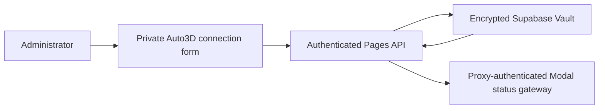

# Modal credential bridge

Auto3D **0.77.0**, Packaging **1.12.0**, Primary Products **0.15.0**, Molded Pulp **0.1.0**. The app changes are a review candidate, not deployed. Cloud 3D Studio **0.3.0** adds the protected connection gateway and Vault deployment runner.

## What is configured

Auto3D's Supabase project `iesepcoxqochycckbwoh` already has Vault. The two Modal migrations were applied on November 16, 2026. All three new RPCs are `SECURITY INVOKER`, have an empty search path, and are executable only by `service_role`. Browser roles cannot call them or access the Vault schema. No new table, public bucket, encryption secret or paid Modal project is required.

Supabase Vault encrypts the entire token pair and target as one secret. Pages reads it using the existing server key; the browser receives saved status and target metadata only. The existing Meshy credentials remain in their private encrypted R2 store.



## Use the form after the candidate is deployed

Open **Preferences → Administrator → Manage Modal connections**. Select the purpose and enter the complete pair from the same Modal workspace. The form never displays saved credentials. Both fields must be re-entered together for rotation.

| Purpose | Token ID | Token secret | Used by |
| --- | --- | --- | --- |
| Deployment | `ak-…` | `as-…` | Trusted Python Vault runner; deploy/SDK access |
| App connection | `wk-…` | `ws-…` | Pages server; protected Web Function access |

Use the workspace slug and an existing Modal environment, not a new billing workspace. The app is `cloud-3d-studio`. App connections also require the deployed gateway's base `https://<workspace>--….modal.run` URL, without a trailing slash, path or query. **Test saved app connection** verifies proxy authentication, network reachability, protocol and target identity. It starts only the small CPU status service; a small amount of Modal usage may be billed. It does not convert CAD. Save alone is not proof that the provider accepts a token.

Commands use the same services: `admin.modal.open`, `admin.modal.inspect`, `admin.modal.test`, `admin.modal.remove`. Token arguments are never accepted by commands or macros. The credential dialog is excluded from app captures and clears both fields on submit, close and account change.

## Save deployment credentials now, before the UI release

You can use the [Supabase Vault dashboard](https://supabase.com/dashboard/project/iesepcoxqochycckbwoh/integrations/vault/secrets) immediately. Choose **Add secret** and use the unique name:

`auto3d/modal/v1/production/deployment`

Copy [this JSON template](modal-deployment-vault-template.json) into the secret value. Replace the workspace, environment and both token placeholders **inside the Vault editor**. It is one JSON secret, not separate ID/secret rows. Keep the schema, profile, purpose, app and empty endpoint as shown. For a preview entry, change both the name's profile and the JSON `profile` to `preview`; use a separate token pair. The revision is an opaque identifier and is replaced automatically on the next form save.

Do not paste real credentials into chat, SQL Editor history, a repository file, a command argument or a screenshot. Vault's editor encrypts the value on save. An authorized database owner can still access Vault secrets; this is protected application storage, not isolation from the database administrator. Do not enable request-body/header logging for these routes.

## Server profile setting

Pages must have `AUTO3D_MODAL_PROFILE=production` in production and `AUTO3D_MODAL_PROFILE=preview` in preview. There is deliberately no fallback. A known Pages branch/profile mismatch fails closed. Preview must also have its own existing Auth/Supabase server configuration; the current preview configuration does not contain those bindings. Do not copy production credentials into previews automatically.

**This configuration change has not been applied.** Automatic approval review rejected a partial Cloudflare environment update because it could replace existing variables and lacked explicit production authorization. Obtain approval and prepare an update that preserves all existing bindings and secrets. The canonical production deployment was unchanged.

## Deployment bridge

On a trusted machine/runner with Python 3.12 and the locked Cloud 3D Studio dependencies, configure the existing Supabase URL and **server** key through its secret manager (`SUPABASE_URL`, `SUPABASE_SECRET_KEY`; legacy `SUPABASE_SERVICE_ROLE_KEY` is also accepted by the runner). This is the one bootstrap identity; the Modal pair is fetched from Vault each time. Never distribute the Supabase server key to end users.

From Cloud 3D Studio:

```bash
uv run python deploy/vault_modal.py --profile production
```

The default checks the deployment token's actual Modal workspace and available environment through the pinned SDK, and never deploys or runs conversion. Tokens remain in process memory; no `.modal.toml` profile is written. Only after target verification and spending-policy review, an authorized operator can explicitly use:

```bash
uv run python deploy/vault_modal.py --profile production --deploy
```

Deployment can incur image-build and subsequent runtime usage. The runner removes alternate Modal authentication variables from the child and does not pass Supabase credentials to it. It withholds provider logs from ordinary output. The gateway uses `requires_proxy_auth=True`, CPU 0.125, 128 MiB requested memory, zero minimum containers and one maximum container. Copy its URL from Modal, create Web Function proxy credentials, then save the app connection and test it from Auto3D.

Credential storage does not remove network restrictions. The current development environment's proxy blocks Modal API access; a trusted runner must be allowed to reach Modal and Supabase. App connection tests execute from Pages, independently of the user's computer firewall. No real Modal token was provided, no Modal app was deployed, and no supplier CAD was uploaded during implementation.

## Validation and current limits

The database fixture [modal-credential-bridge.sql](../database/tests/modal-credential-bridge.sql) verifies encrypted storage, read-back, rotation, conflict detection and removal with rolled-back synthetic credentials. It refuses an occupied preview runtime slot. Browser-role RPC execution is denied. The post-migration security advisory review found no new warning; existing no-policy informational findings and the existing leaked-password-protection warning are unchanged.

Local checks cover the administrator API, CSRF/account/revoked-session gates, token type isolation, destination restrictions, safe errors, stale edits, secret-free commands, desktop/mobile form flows, logout cleanup and the actual Workers runtime. The Studio tests cover the metadata gateway, explicit deployment gating, workspace/environment checks, header compatibility and credential handling. This proves the bridge implementation, not live Modal authentication. Owned CAD jobs, private file transfer, progress and Auto3D scene import remain the next milestone.
