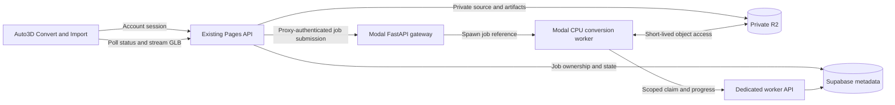

# Modal conversion service and Auto3D connector

Draft implementation plan, 2026-11-16. Reviewed against Auto3D main `70601cd5cebe14104ac5b1f431ca449f129754b5`: Auto3D 0.74.0 / Packaging 1.10.7 / Primary Products 0.15.0 / Molded Pulp 0.1.0. This document proposes a service; it does not deploy Modal, apply database changes or enable production import formats.

The user has chosen hosted Modal processing after evaluating local installation. Keep the [local converter download](parasolid-local-converter.md) as an alternative. Hosted processing means CAD leaves the user's computer for private processing; it does not mean publishing the model.

## 1. Recommended format contract

Use one conversion job to produce these outputs from supported Parasolid `.x_t` / `.x_b` files:

| Artifact | Purpose | Units and fidelity |
| --- | --- | --- |
| AP242 STEP | Downloadable engineering source | Explicit millimeters; preserves supported converted surfaces and topology. |
| GLB / glTF 2.0 | Default artifact imported into Auto3D | Standard meters; one mesh/node per available body occurrence, with placements preserved. |
| Binary STL | Broad mesh interchange and downstream tooling | Coordinates written in millimeters; the format carries no reliable unit declaration, so pair it with the conversion manifest. |
| JSON manifest | Provenance, measurements and validation | Source hash/unit/schema, converter versions, artifacts, body/instance counts, bounds in mm, mesh settings and checks. |

STL is useful as a universal mesh download, but it discards CAD surfaces, hierarchy and standard appearance information. A combined STL must be described as combined positioned triangles, not a Boolean union of an assembly. Offer separate-body STL packaging later if customers need it. STEP and GLB avoid making STL's missing units the default import contract. [STL format description](https://www.loc.gov/preservation/digital/formats/fdd/fdd000504.shtml); [glTF coordinate and unit specification](https://registry.khronos.org/glTF/specs/2.0/glTF-2.0.html).

The current reader does not promise feature history, PMI, original CAD appearance or a complete named product hierarchy. Do not invent material or part-name fidelity. Generated body IDs can be stable even when the source has no usable names. The Auto3D scene remains editable mesh geometry; retaining STEP is separate from adding an exact CAD modeling kernel to Auto3D.

## 2. Architecture



Keep the current Pages application and identity system. The existing Node Library backend is an alternate implementation and should not become the production connector by accident. Native Python/OpenCascade runs on Modal, rather than inside Pages Functions.

Use Supabase as the authoritative job store and R2 as the binary store. Modal's function-call result cache is not durable application history. CAD bytes must not be serialized into `.spawn()` arguments/results; the worker downloads the source after starting and writes artifacts directly to R2. [Modal job processing](https://modal.com/docs/guide/job-queue).

## 3. Modal application

Create a separately deployable `services/converter/` package. Promote the tested local converter into importable production functions; do not deploy by unpacking the downloadable ZIP at runtime.

| File | Responsibility |
| --- | --- |
| `modal_app.py` | CPU image, authenticated gateway, worker, bounded status/cancel methods and scheduled reconciliation. |
| `contracts.py` | Strict request/result schemas and versioned error codes. |
| `converter.py` | Parse, explicit units, placed instances, complete B-Rep conversion and validated STEP. |
| `mesh_export.py` | One controlled tessellation used for GLB and STL; output and triangle limits. |
| `job_client.py` | Scoped worker claims, progress, artifact transfer, cancellation and completion. |
| `requirements.lock` | Pinned Modal SDK, parser, OCP and mesh/HTTP dependencies with reviewed licenses. |
| `tests/` | Geometry, scale, mesh quality, transfer, failure and isolation tests. |

Start with Python 3.12, `parasolid-kit[occt]==0.3.17`, `cadquery-ocp-novtk==7.9.3.1.1` and `cadquery-ocp-proxy==7.9.3.1.1`. Verify the current supported release before implementation; upgrades require rerunning the acceptance corpus. Pin the Modal SDK and any GLB exporter after the deployment spike. A focused OCP tessellation adapter plus a reviewed mesh writer such as Trimesh is a candidate, not an already-verified component.

Build images from an explicit source allowlist. Install dependencies during image construction. Never include customer inputs, private folders, credentials or generated CAD in an image. Use a temporary per-job directory and cleanup in `finally`; no persistent customer-data Volume and no enabled memory snapshots for the conversion worker.

Proposed starting settings, to benchmark rather than treat as measured capacity:

| Setting | Initial proposal |
| --- | --- |
| Worker compute | CPU only; `cpu=(2.0, 2.0)` physical cores, approximately four vCPU equivalent. |
| Worker memory | `memory=(4096, 8192)` MiB: 4 GiB request, 8 GiB hard cap. |
| Scaling | `min_containers=0`, `max_containers=2`, one conversion per container at a time. |
| Native conversion deadline | 480 seconds, including CAD/mesh validation. |
| Modal worker deadline | 900 seconds, allowing transfers and cleanup. |
| Input cap | 50 MiB for the first release; raise only after upload/runtime/browser benchmarks. |
| Output caps | 256 MiB per artifact, 512 MiB total, initially at most three million triangles. |
| Attempts | At most two application-controlled attempts, within a fixed overall job deadline. |
| Per-account quota | One running job and a small bounded pending queue; configurable. |

Modal requests and limits are distinct, and CPU units are physical cores. Review the local prototype's 4 GiB address-space and CPU limits before moving it unchanged into an 8 GiB Modal container; virtual address space is not the same as resident RAM. [Modal resource settings](https://modal.com/docs/guide/resources).

Use `modal.asgi_app(requires_proxy_auth=True)` for the small FastAPI gateway. Cloudflare supplies `Modal-Key` / `Modal-Secret` from server-only configuration. Separate deployment credentials from proxy credentials. The browser never receives either. [Modal proxy authentication](https://modal.com/docs/guide/webhook-proxy-auth).

The gateway validates a small job-reference request, calls `convert_job.spawn(...)`, and returns promptly. Do not hold a browser HTTP request open through conversion: Modal Web Functions have a 150-second HTTP timeout. [Request timeouts and asynchronous polling](https://modal.com/docs/guide/webhook-timeouts).

## 4. Private upload and job lifecycle

1. A signed-in user selects Parasolid, confirms the actual source-coordinate unit, chooses mesh quality and presses **Convert on Modal**. This action uploads for processing; ordinary local formats retain their current local path.
2. Pages creates an owned job with an idempotency key, input constraints, output recipe and originating browser/session identifiers. Ownership comes from the verified session, not request-supplied account data.
3. The browser streams the file to a new same-origin upload route. Enforce declared and actual byte limits and a verified source SHA-256. The first release can stay below Cloudflare's applicable request limits; use a dedicated streaming implementation rather than increasing the existing buffered Library helper.
4. Store the source under an opaque private R2 key, such as `conversion-jobs/<owner>/<job>/source.x_t`. Raw filenames do not become object paths. Finalize upload only after size and checksum validation.
5. Commit `queued` state before dispatch. The Modal gateway receives only the opaque job ID, attempt ID and an expiring job-scoped claim token; return the Modal call ID to the connector and persist it privately.
6. When the worker actually starts, it claims the job through a dedicated worker route. An atomic lease prevents duplicate expensive work. Issue fresh, short-lived R2 GET/PUT URLs for exactly that source and that attempt's artifact keys. Do not issue them long before a potentially delayed queue start.
7. The worker downloads into its job directory, checks size/hash, performs strict conversion, exports and reopens the artifacts, then uploads them to the assigned attempt keys. Avoid arbitrary input URLs and redirects.
8. Worker progress/completion calls use the job-scoped token, attempt ID and monotonic revision. Pages verifies the active lease, expected artifact keys, sizes, checksums and manifest before moving to `ready`.
9. Auto3D polls its own authenticated status route with backoff. It imports GLB only after the validated job is ready, or presents **Add to session** if the original scene is no longer active. STEP, STL and the manifest have owned download routes.
10. Saving the imported scene to an account Library remains an explicit existing Save action. A successful conversion does not publish or automatically save a Library item.

Presigned URLs grant temporary access to one object operation. Mint them server-side after ownership/attempt checks, keep them out of logs, and expire them quickly. R2 credentials stay on Cloudflare; the native worker does not receive a bucket-wide key. [R2 presigned URLs](https://developers.cloudflare.com/r2/api/s3/presigned-urls/).

## 5. Connector routes and authentication

Proposed public application routes:

| Route | Contract |
| --- | --- |
| `POST /api/conversions/jobs` | Create an owned job and reserve quotas; idempotent submission key. |
| `PUT /api/conversions/jobs/:id/source` | Bounded source upload, restricted to the initial upload state. |
| `POST /api/conversions/jobs/:id/submit` | Finalize verified upload and request dispatch; return 202. |
| `GET /api/conversions/jobs/:id` | Owned state, stage, safe diagnostics and available formats. |
| `GET /api/conversions/jobs/:id/artifacts/:format` | Stream only the owner's ready artifact; private/no-store response. |
| `POST /api/conversions/jobs/:id/cancel` | Request cancellation and immediately prevent result publication/import. |
| `DELETE /api/conversions/jobs/:id` | Tombstone and delete temporary owned assets. |

Create `functions/api/conversions/[[path]].js` and shared helpers under `functions/_lib/`. Reuse verified account sessions, logout/revocation checks, the account-change header and same-origin mutation checks. Foreign jobs return no useful information. Stream artifact responses instead of buffering large binaries in a Worker.

**Do not put service callbacks behind the browser-session API middleware.** Current `functions/api/_middleware.js` requires cookies and a matching Origin for POST; Modal has neither. Add a narrowly authenticated route such as `functions/internal/conversion-worker/[[path]].js` for claim, heartbeat, completion and reconciliation. Validate its scoped token, audience, expiry, job and attempt. Leave the existing `/api` account protections intact. Ensure route names do not accidentally trigger the root middleware's protected-model-file suffix handling.

Example create request; values are illustrative, not a test result:

```json
{
  "source_name": "product.x_t",
  "source_size_bytes": 123456,
  "source_sha256": "<64 hex characters>",
  "source_coordinate_unit": "m",
  "outputs": ["step", "glb", "stl"],
  "quality": "standard",
  "origin": {"window_id": "<window>", "session_id": "<session>"}
}
```

`source_coordinate_unit` is required and has no default. Supported choices are `m`, `cm`, `mm`, `in`, `ft`. A CAD application's display unit may differ from the exported coordinate unit; check a known dimension when uncertain. Window/session IDs correlate results to a scene; they do not authorize access to files or another account.

Return `{schema_version, job_id, state, stage, revision, poll_after_ms, artifacts, error}` with strict schemas. Never expose a raw provider exception, service token or signed URL through public diagnostics. Examples of actionable errors: `source_units_required`, `unsupported_parasolid_schema`, `unsupported_geometry`, `input_too_large`, `conversion_timeout`, `mesh_validation_failed`, `source_hash_mismatch`, `account_changed`.

## 6. Job data and reliability

Add an owned `auto3d_conversion_jobs` table and, if useful for multiple outputs, an `auto3d_conversion_artifacts` table. Inspect the existing schema before authoring the new migration. Generate the migration using the pinned installed Supabase CLI; check its version/help first because CLI v3 changed local/hosted defaults. Never replay historical prototype SQL. [Current Supabase changelog](https://supabase.com/changelog.md).

Job fields: owner ID, job ID, idempotency key, source metadata/key/hash/unit, requested outputs, quality, state/stage, revision, attempt ID/count, dispatch state, Modal call ID, lease/heartbeat/deadline timestamps, artifact metadata, safe error code, created/completed/expiry/deleted timestamps and originating window/session. Index ownership/history and pending dispatch/expiry lookups. Deduplication, if added, is scoped to one account and includes source hash, units, recipe and converter version.

Enable RLS, revoke client-role table/function access, and explicitly grant only the server role the access it needs. Verify Data API exposure/grants for new tables; current Supabase does not automatically expose new tables. Every privileged Pages query must still scope ownership because a server secret bypasses RLS. Scope worker mutations to a validated job capability. [Supabase RLS and server-key behavior](https://supabase.com/docs/guides/database/postgres/row-level-security).

Public lifecycle: `awaiting_upload → queued → running → ready`, plus `cancelling`, `cancelled`, `failed`, `expired`. Store stages such as reading, building CAD, validating CAD, meshing, validating mesh and uploading; show actual stages rather than fabricated time percentages.

Use the durable job row as the dispatch outbox. A scheduled reconciler in the separate Modal control function repairs pending dispatch, lost acknowledgements, stale leases, missed completion and expiry. Its narrowly scoped control credential can invoke only reconciliation routes; do not attach that credential to native parser workers. Recoverable work must not depend solely on a browser remaining open or Pages `waitUntil` finishing.

Assume duplicate delivery and infrastructure restarts. Increment/claim attempts atomically; use attempt-specific output keys and compare-and-set state transitions. Retry transient transfer/provider failures only. Unsupported geometry, invalid units and validation failures require a corrected request. Modal can reschedule crashed deployed containers beyond ordinary retry settings, so application attempt/deadline checks must remain authoritative. [Modal failure behavior](https://modal.com/docs/guide/retries).

Cancellation blocks imports immediately and requests provider cancellation; describe stop/cleanup as pending until confirmed. Late callbacks cannot resurrect a cancelled, expired or superseded attempt. Clean late artifact uploads again after their signed-write capability expires.

## 7. Geometry, meshing and unit validation

Reuse the strict prototype's pipeline: parse supported input, preserve source identity, place assembly occurrences, convert to valid OCCT with complete-source requirements, disable partial conversion and automatic healing, then write millimeter STEP and cold-reimport it in another process.

Tessellate the validated placed B-Rep once, then export that mesh to GLB and binary STL. Apply each face/instance transform once; respect reversed face orientation. Use named quality settings with explicit canonical-mm error budgets, for example standard 0.10 mm and fine 0.05 mm as starting proposals. Benchmark small features and curved surfaces before finalizing them. No silent decimation, hole filling or geometry omission when a limit is reached.

- Verify finite coordinates, nonempty output, counts and placements, consistent normals, degenerate triangles, mesh bounds and sampled surface deviation from CAD.
- Check closed/manifold meshes for bodies expected to be solids. Distinguish intentionally open sheet bodies from damaged solids; do not report every assembly as one watertight union.
- Reopen STEP and both mesh exports with independent readers/validators. Validate GLB structure and compare physical dimensions in mm across all three outputs within the chosen tessellation and floating-point budgets.
- Write STL coordinates in mm and a separate unit manifest. Standard GLB must contain meter-scale geometry and translations; convert mm by 0.001 exactly once. Do not reuse the prototype library's millimeter preview GLB unchanged.
- Record body/instance counts, output hashes and validation evidence privately. If a requested required artifact fails, do not label the full job successful.

Known prerequisite: `parasolid-kit` supports a subset of schemas and surface types. The earlier 11 tests covered synthetic typed B-Rep conversion and failure handling; they did not positively certify a supplier Parasolid file. STL output cannot compensate for an unsupported source surface. The first acceptance gate must use the user's sample and representative curved/assembly files. Report unsupported features and allow an explicitly supplied STEP alternative; do not silently send CAD to another converter. [Reader support matrix](https://github.com/monozukuri-ai/parasolid-kit/blob/main/docs/format-support.md).

## 8. Auto3D integration and agent commands

Add `source/website/conversionservice.js` for authenticated jobs, transfers, progress/cancellation and account-change invalidation, and `conversiondialog.js` for file, unit and quality selection plus ready-result actions. Keep this in the host/import workflow rather than putting conversion logic inside Packaging, Primary Products, Molded Pulp or AIWorkspace.

Intercept Parasolid in the shared `Website.LoadModelFromFileList` path before the ordinary engine import. Preserve existing `.auto3d` and local-format behavior. The first release can convert one Parasolid input at a time; mixed selections must receive an explicit choice rather than silently skipping files. Enable picker extensions and format labels only when conversion is configured and available.

Import validated GLB through the existing loader and `SessionEditor.Import` so selection, materials, history, scene persistence and fitting stay consistent. Include STEP/STL download actions and a concise dimensions/validation summary. Persist conversion provenance in optional archive-safe metadata, with no credentials or transient access URLs.

**Normalize physical units before insertion.** `SessionEditor.Import` marks GLB as meters, while `SceneDocument.AddImported` only adopts units for the first object and does not itself rescale a later asset into the existing scene. Use a shared import adapter with an explicit meter-to-current-scene conversion. Test millimeter, meter and inch scenes; an unknown-unit scene needs an explicit choice. Do not silently rotate or recenter an assembly, and test its frame against STEP as well as its overall size. This change should be scoped to the conversion path unless a separate general import repair is requested.

Capture the originating account epoch, browser window, scene/session, revision and replacement target. Results may finish after the user changes accounts, opens another tab or deletes a replacement target. Keep the result as an owned ready job and ask for an explicit Add action in that case; never insert into whichever scene happens to be active. Auto-import, when requested, must recheck the intended target at commit time and create one undoable change.

Register shared strict commands in `source/website/agentcommands.js` and regenerate the command/MCP catalogs:

| Command | Behavior |
| --- | --- |
| `conversion.open` | Opens the interactive file/unit dialog; reports opened, not converted. |
| `conversion.submit` | Converts an already uploaded, approved, owned source with units/output recipe; returns a real queued job. No arbitrary URLs or local paths. |
| `conversion.status` | Nonmutating owned status and safe diagnostics. |
| `conversion.artifacts` | Lists owned format metadata and authenticated download routes. |
| `conversion.cancel` | Requests cancellation with an accurate pending/terminal result. |
| `conversion.import` | Imports a ready result into the paired, writable intended session; returns object ID on completion. |

Scene mutations respect read-only sessions and the existing write grant. Remote submission requires an explicit upload/conversion action; opening a picker or approving generic agent access is not a false conversion completion. Use the existing coded MCP error conventions.

Current account archives are capped at 32 MiB in `functions/_lib/accountstorage.js`. Conversion input/output limits are separate. Do not silently increase Library limits or promise that an arbitrary STEP attachment is already supported there. Save the imported scene through the existing Library path when it fits; offer local downloads for large scenes and engineering STEP. Permanent source-artifact storage is a separate explicit feature.

## 9. Privacy and retention

Keep R2 buckets private, downloads authenticated and responses out of shared caches. Only the account owner and scoped service operations can read the job. Logs contain job IDs, stages, timing and safe codes; redact filenames, geometry, request bodies, tokens and signed URLs.

Modal documents Function argument/result retention of up to seven days. Pass only short-lived job references/capabilities through that mechanism; obtain CAD and private reports directly from object storage inside the worker. Region pinning alone does not control every retained metadata path. No customer-data Volumes or memory snapshots are part of this design. This is private hosted processing, not a zero-retention guarantee. [Modal security and retention](https://modal.com/docs/guide/security); [Modal residency controls](https://modal.com/docs/guide/data-residency).

Proposed application policy: delete source after successful validated output; remove failed/cancelled sources and orphan uploads within one hour; keep temporary outputs for 24 hours and minimal owned job history for seven days. A scheduled sweeper performs hour-level cleanup; R2 lifecycle rules are a backstop. Stop serving an expired artifact immediately even if physical cleanup is still pending. Original files on the user's computer are unaffected. Explicit Library saves have the existing Library retention policy.

## 10. Delivery sequence and acceptance gates

| Phase | Deliverable | Acceptance gate | Estimate |
| --- | --- | --- | --- |
| A. Geometry proof | Pinned Modal image, synthetic tests, secure staging sample run, STEP/STL and candidate GLB writer. | User sample parses/converts; a known dimension, body placement and curved features match. | 1–2 days. |
| B. Native service | Authenticated asynchronous gateway, scoped worker claims, mesh validation, quotas and bounded execution. | No anonymous execution; long jobs succeed without an open HTTP request; required artifacts reopen correctly. | 1–2 days. |
| C. Connector/storage | Owned jobs/migration, private streaming upload/download, dispatch, retries, cancellation and cleanup. | Two-account isolation, duplicate submissions, provider outage, callback loss and expiry tests pass. | 2–3 days. |
| D. Auto3D workflow | Convert dialog, real stages, GLB import, STEP/STL downloads, strict commands and archive-safe provenance. | Correct scale in empty/existing scenes; one-step Undo; account/session switching cannot misroute a result. | 1–2 days. |
| E. Staging rollout | Real-file corpus, mobile/desktop and multi-window flow, performance/cost report, feature flag and rollback. | No silent geometry loss; acceptable agreed tolerances/time/memory; production deployment is separately reviewable. | 1–2 days. |

Allow roughly one to two working weeks after the sample passes; these are planning estimates, not benchmarks or a delivery guarantee. Source-reader feature work can extend the schedule and must be identified in Phase A rather than hidden in UI work. Give the user's confidential file a private staging upload path; do not commit it or require a chat attachment.

Verification must cover malformed/unsupported text and binary sources, mm/m/in scaling, rotated/repeated assemblies, sheets/solids/NURBS/holes, large input/output limits, empty output, native crash/OOM, immutable originals, and output hash consistency. Service tests cover expired scopes, wrong owners/attempts, upload races, replay, cancellation versus completion, logout/account changes, stale scenes, read-only agents and no secrets in catalog/archive/logs. Browser tests cover picker and drag/drop, progress, downloads, known dimensions, target-session import and Undo/Redo.

Use separate Modal staging/production Apps, object prefixes or buckets and scoped secrets. Pin source/image versions. Deploy the service and backwards-compatible API/schema before enabling the client feature flag. Start with an allowlisted account and the reference file, then expand after evidence. CI can test/build artifacts without deploying. Rollback disables new submissions through the flag, preserves existing local imports and drains or cancels owned jobs; provider and API compatibility must cover in-flight attempts.

## 11. Operating cost and prerequisites

Measure billed startup, conversion, transfer, cleanup and any warm time. As a current illustration, Modal lists CPU at $0.0000131 per physical-core-second and memory at $0.00000222 per GiB-second. Sixty billed seconds at two cores and 4 GiB is approximately $0.0021 compute, or $2.10 for 1,000 such jobs. This excludes higher actual memory/CPU usage, retries, warm time, region multipliers, plan charges, storage/API operations and applicable network egress; it is not a measured CAD price. [Modal pricing](https://modal.com/pricing).

Before the staging run, prepare the target Modal workspace/environment, deployment identity, server-only proxy credentials, chosen region, private R2 namespace and scoped signing configuration, worker-capability signing keys, job migration and feature flag. Confirm actual source units or a known dimension for the reference file. Review the current pinned parser/OCCT/exporter license notices when packaging the image. Keep account/provider secrets out of Git, chat, browser code and customer archives.

The first implementation milestone is a private Modal job that successfully converts the reference Parasolid and returns independently validated STEP, GLB and STL with matching physical dimensions. Only then enable the Auto3D workflow for that account.
